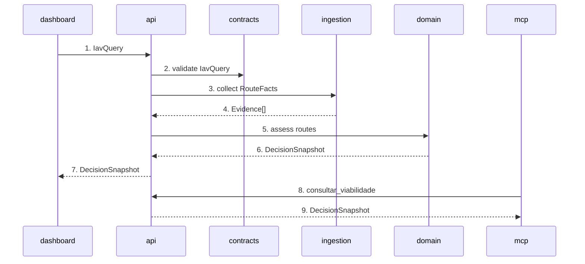
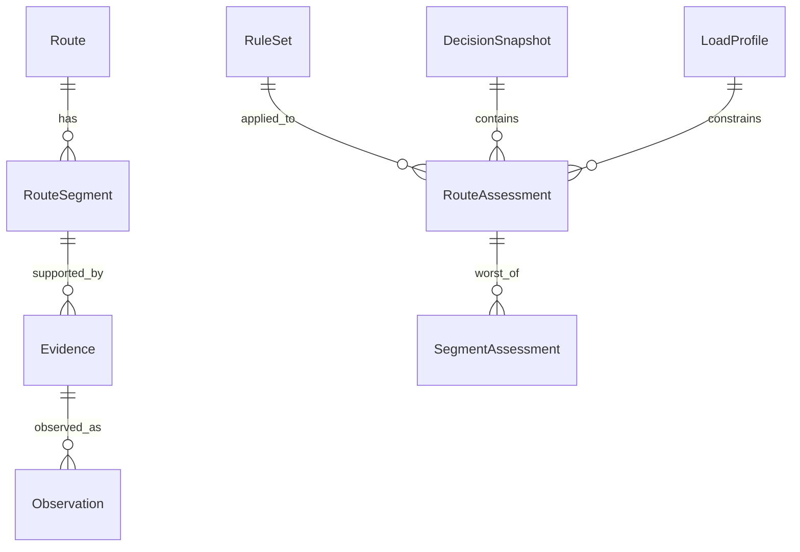

# rotazfm-mvp

**Approved**: 2026-11-23 - user: "aprovo o plano com essa ressalvas"; "voce tem autorizzacao para editar a pr"
**Settled mid-build:** none
**Review:** not sent yet
**Fix pass:** not done yet

## Problem

Empresas do Polo Industrial de Manaus precisam escolher entre duas rotas de escoamento para Manaus → São Paulo, mas os dados que sustentam a decisão estão dispersos em fontes públicas, boletins, portarias e notícias. Hoje uma decisão de embarque pode ser tomada sem uma resposta única, explicável e auditável para "esta rota pode operar nesta data com esta carga?". O custo disso é risco de atraso, retorno de carga, contato manual com fontes e impossibilidade de auditoria posterior.

Quando o MVP estiver pronto, o usuário informa origem, destino, data de embarque e perfil mínimo de carga e recebe, para cada rota candidata, um IAV por trecho consolidado no pior trecho, bloqueadores, evidências, dados faltantes, notícia relacionada contextual e a versão das regras usada. O sistema declara quando não pode avaliar em vez de publicar um número sem lastro.

## Shape

O MVP reusa o monorepo existente (`apps/`, `packages/`, `data/`) em vez de criar microserviços; as fronteiras ficam em pacotes para permitir extração futura. As regras que mudam o resultado — composição do IAV, bloqueadores, frescor, conflito e `NAO_AVALIAVEL` — rodam em `packages/domain`, uma camada pura coberta por `node:test`.

1. `IavQuery` -> `packages/contracts` (door 1) - valida origem, destino, data, `carga.tipo`, `carga.peso_bruto_total_kg` e rejeita campos extras.
2. `apps/api` (new) - carrega data/routes/mvp-routes.json (door 2), pede evidências a `packages/ingestion` (new) e entrega `RouteFacts` ao motor.
3. `packages/domain` (new) - consolida `SegmentAssessment` por trecho e `RouteAssessment` por rota com regra `min`, bloqueadores e status `VIAVEL | VIAVEL_COM_RESSALVAS | NAO_VIAVEL | NAO_AVALIAVEL`.
4. `apps/mcp` (new) - expõe `consultar_viabilidade` com Bearer auth, rate limit e o mesmo contrato da API.
5. out: `DecisionSnapshot`; `apps/dashboard` (new) lê o mesmo contrato e mostra evidências, faltantes, frescor e notícias contextuais.

**Changes underneath**

| Front | What changes |
| --- | --- |
| domain | Não existe domínio hoje; `packages/domain` passa a ser a única camada que decide IAV, bloqueadores e `NAO_AVALIAVEL`. |
| stored data | Nada migrado ainda; o primeiro schema persistido é o da porta 1 e deve nascer com `raw_payloads`, `evidences`, `route_condition_facts` e `decision_snapshots`. |
| readers | `apps/dashboard` e `apps/mcp` passam a ler `DecisionSnapshot`; nenhum lê banco direto. |
| routes | `data/routes/mvp-routes.json` vira a fonte versionada das duas rotas e trechos aprovadas por Lucas. |

New: todas as entidades acima são novas; a relação `RouteAssessment` consolida por `min(SegmentAssessment.iav)` e bloqueadores têm precedência sobre score.

## Surface

| Route | In | Out | Status | Who |
| --- | --- | --- | --- | --- |
| `POST /v1/viabilidade` | `origem`, `destino`, `data_embarque`, `carga.tipo`, `carga.peso_bruto_total_kg` | `DecisionSnapshot` | `200`, `400`, `401`, `404`, `429`, `503` | dashboard e agentes com `Authorization: Bearer <IAV_MCP_API_KEY>`; demais recebem `401` |
| `consultar_viabilidade` (MCP) | mesmos campos de `IavQuery` | `DecisionSnapshot` + `scope_warning` | `200`, `400`, `401`, `404`, `429`, `503` | agentes MCP autenticados; sem chave recebem `401` |
| `GET /v1/fontes` | nenhum corpo | lista de fontes com status e última coleta | `200`, `401`, `503` | dashboard autenticado; sem chave recebem `401` |
| `GET /v1/noticias` | `rota_id`, `janela_horas` | notícias contextuais filtradas por rota/trecho | `200`, `400`, `401`, `503` | dashboard autenticado; sem chave recebem `401` |

## Landing

| One-way door | Literal shape | Alternative rejected |
| --- | --- | --- |
| Contrato de decisão | `DecisionSnapshot { rule_version, query, routes[], missing_data[], scope_warning }`; cada `RouteAssessment` tem `status`, `iav` ou `null`, `blockers[]`, `evidences[]`, `worst_segment_id` | Resposta só com `iav` e `viavel`: não prova bloqueador, falta dado nem rastreabilidade. |
| Catálogo de rotas | `data/routes/mvp-routes.json` versionado com `routes[].id`, `routes[].segments[].id`, `from`, `to`, `road`, `mode`, `critical` | Rotas hardcoded em `packages/domain`: impede auditoria, segmentação e reutilização futura. |
| Persistência de evidência | `raw_payloads` antes de `evidences`/`route_condition_facts`; toda evidência tem `source`, `source_url`, `published_at`, `collected_at`, `method`, `content_hash`, `confirmation_status`, `effective_from`, `effective_until` | Salvar só score/fato normalizado: perde payload bruto, hash e janela de validade para reprocessamento. |
| Perfil de carga | `LoadProfile { tipo: "SECA" | "CONTEINERIZADA", peso_bruto_total_kg: integer, quantidade_caminhoes?: integer }`; PBTC compara por trecho | Aceitar qualquer JSON de carga: não dá para aplicar restrição de peso nem explicar a decisão. |
| Auth e rate limit MCP | `Authorization: Bearer <IAV_MCP_API_KEY>` e limite de `60` requisições/minuto por chave | MCP aberto: agente pode consultar sem controle e sem trilha de uso. |
| Segredos | `.env.example` lista nomes; `.env` real nunca é commitado | Commitar chaves ou defaults secretos no repo. |
| Deploy | Nenhum deploy público até a etapa final; alvo final é Vercel | Deploy incremental na Cloudflare/Vercel durante o build: o usuário pediu Vercel só no final. |

- Nothing else in this change is hard to reverse

## Criteria

### S1: contratos, catálogo de rotas e motor determinístico com fixtures (P1)

O usuário consegue receber uma decisão IAV reproduzível para as duas rotas sem depender de fonte externa.

**Acceptance Criteria**

1. WHEN `IavQuery` tem `origem = "MANAUS"`, `destino = "SAO_PAULO"`, `data_embarque` entre hoje e hoje+4 dias, `carga.tipo = "SECA"` e `carga.peso_bruto_total_kg = 10000` THEN `packages/contracts` SHALL aceitar a consulta e `packages/domain` SHALL retornar duas `RouteAssessment`.
2. IF `carga.peso_bruto_total_kg` for maior que o PBTC do trecho THEN `packages/domain` SHALL marcar a rota como `NAO_VIAVEL` com `blockers[]` contendo o trecho e a portaria, independentemente do `iav`.
3. WHEN uma dimensão obrigatória estiver ausente, com `freshness_hours > 24` ou com `confirmation_status = "CONFLITANTE"` THEN `packages/domain` SHALL retornar `status = "NAO_AVALIAVEL"`, `iav = null` e `missing_data[]` listando a dimensão e o trecho.
4. WHEN a mesma `IavQuery` e o mesmo `rule_version` forem avaliados duas vezes THEN `packages/domain` SHALL retornar o mesmo `DecisionSnapshot` em `iav`, `status`, `blockers[]` e `worst_segment_id`.
5. WHEN `data/routes/mvp-routes.json` for carregado THEN ele SHALL conter as duas rotas aprovadas e a `RouteAssessment` SHALL usar `min` dos `SegmentAssessment` por rota.

### S2: evidências, frescor, conflito e filtro de notícias (P1)

Toda decisão tem lastro auditável e notícia não vira bloqueador sem confirmação oficial.

**Acceptance Criteria**

6. WHEN `packages/ingestion` coleta uma fonte THEN ele SHALL gravar `raw_payloads` com `content_hash` antes de publicar `evidences`/`route_condition_facts`.
7. IF a fonte falhar ou o dado estiver expirado THEN o sistema SHALL reutilizar a última observação válida com `freshness_hours`, `last_valid_at` e `alert` visíveis, sem tratar como atual.
8. WHEN duas fontes oficiais divergirem para a mesma dimensão e trecho THEN `packages/domain` SHALL marcar `confirmation_status = "CONFLITANTE"` e `status = "NAO_AVALIAVEL"` para aquela dimensão.
9. WHEN uma notícia for classificada como relacionada a rota/trecho THEN ela SHALL aparecer em `related_news[]` com `source`, `published_at`, `url` e `confirmation_status`, e SHALL NOT criar `blockers[]` sem `confirmation_status = "CONFIRMADO"`.
10. WHEN `FIRECRAWL_API_KEY` estiver ausente THEN `packages/ingestion` SHALL usar somente fixtures HTTP locais e SHALL NOT chamar Firecrawl/Alexandria.

### S3: API interna e MCP autenticado (P1)

Agentes e dashboard consomem o mesmo contrato com segurança mínima.

**Acceptance Criteria**

11. WHEN `consultar_viabilidade` receber `Authorization: Bearer <IAV_MCP_API_KEY>` válido e `IavQuery` válido THEN o MCP SHALL retornar `DecisionSnapshot` com `routes[]`, `evidences[]`, `blockers[]`, `missing_data[]`, `justification_template`, `rule_version` e `scope_warning`.
12. IF a chamada MCP não tiver chave ou tiver chave inválida THEN o servidor SHALL retornar `401` e SHALL NOT executar coleta nem cálculo.
13. IF a chamada exceder `60` requisições/minuto por chave THEN o servidor SHALL retornar `429` com `retry_after_seconds`.
14. IF `IavQuery` tiver campo extra, `data_embarque` fora da janela ou `peso_bruto_total_kg` fora de `1..60000` THEN a API SHALL retornar `400` com `error.code = "INVALID_QUERY"`.
15. WHEN `route_id` não existir no catálogo THEN a API SHALL retornar `404` com `error.code = "ROUTE_NOT_FOUND"`.

### S4: dashboard mínimo na Vercel só no final (P2)

O gestor vê a decisão sem recalcular nada.

**Acceptance Criteria**

16. WHEN o usuário submeter origem, destino, data e carga THEN o dashboard SHALL mostrar as duas rotas com `status`, `iav` ou `NAO_AVALIAVEL`, `worst_segment_id`, `blockers[]`, `missing_data[]`, evidências e `related_news[]`.
17. WHILE uma fonte estiver indisponível THE dashboard SHALL mostrar `last_valid_at` e `freshness_hours` ao lado do valor usado.
18. WHEN a decisão for `NAO_AVALIAVEL` THEN o dashboard SHALL NOT exibir `iav` numérico como se fosse aprovação.
19. WHEN o usuário clicar em uma evidência THEN o dashboard SHALL abrir `source_url` e mostrar `collected_at`, `method` e `confirmation_status`.

### S5: validação substituta e retrospectivo documental (P1)

A validação não depende de entrevista com gestor.

**Acceptance Criteria**

20. WHEN a matriz de cenários `C01..C20` rodar THEN cada cenário SHALL ter `input`, `fixtures`, `expected_status`, `expected_iav` ou `expected_null` e `expected_blockers[]` em `tests/e2e/scenarios.json`.
21. WHEN o caso retrospectivo for escolhido THEN `docs/VALIDATION.md` SHALL registrar fonte primária, período, definição de "resultado ruim" escrita antes da análise e resultado reproduzível ou descarte formal.
22. WHEN nenhuma fonte oficial cobrir um trecho crítico THEN o sistema SHALL marcar `NAO_AVALIAVEL` para o trecho e SHALL NOT completar com dado não oficial.

### S6: empacotamento e deploy final (P2)

O projeto continua simples, auditável e publicável uma vez.

**Acceptance Criteria**

23. WHEN `npm run lint`, `npm run test` e `npm run build` rodarem no Node `>=22.18` THEN todos SHALL sair com código `0` sem depender de serviço externo.
24. WHEN `.env.example` for comparado ao código THEN toda variável lida pelo sistema SHALL existir em `.env.example` com comentário de finalidade e sem valor secreto.
25. WHEN a etapa final for aprovada THEN o deploy público SHALL acontecer na Vercel em uma única versão, com `NEXT_PUBLIC_API_URL` apontando para a API/MCP públicos.

## Out of scope

| Excluded | Why |
| --- | --- |
| LLM calculando IAV ou escolhendo rota | Determinismo e auditabilidade são requisito central. |
| Otimização de custo real ou ordenação por preço | Custo é camada separada e opcional; MVP mede viabilidade. |
| Greves, combustível, disponibilidade de caminhão/motorista, bloqueios políticos | Fora do modelo de evidências do MVP. |
| Microserviços reais ou fila distribuída | Monorepo modular resolve o MVP; extração futura fica para depois. |
| WorkOS, cobrança, 3D, múltiplas rotas além das duas aprovadas | Escopo de hackathon; cortes já decididos. |
| Airflow/Prefect/DuckDB como caminho crítico | Complexidade desnecessária para poucas fontes. |
| PRF como sexta dimensão | Não é uma das cinco dimensões do IAV. |
| Deploy público antes da etapa final | Lucas determinou Vercel só no final. |

## Assumptions

| Assumption | Chosen default | Rationale | Confirmed? |
| --- | --- | --- | --- |
| Nome do índice | `IAV` — Índice de Antecipação de Viabilidade | Lucas determinou "O nome sera IAV". | y |
| Rotas do MVP | Exatamente as duas rotas e trechos descritos por Lucas em 23/11/2026 | Lucas forneceu o catálogo detalhado para evitar rota caixa-preta. | y |
| Perfil mínimo de carga | `tipo` = `SECA` ou `CONTEINERIZADA`; `peso_bruto_total_kg` obrigatório; `quantidade_caminhoes` opcional | Lucas determinou carga seca/containerizada com peso bruto total por caminhão. | y |
| Dado ausente/desatualizado | Usar última atualização válida com `freshness_hours` e `last_valid_at`; se dimensão obrigatória continuar ausente/inconsistente, `NAO_AVALIAVEL` sem `iav` numérico | Lucas pediu "ausenica de dadospuxar ultima atualziar"; crítica exige não publicar score sem lastro. | y |
| Notícia relacionada | Aparece como evidência contextual com fonte/data/url; nunca bloqueia sem confirmação oficial | Lucas pediu filtro de notícias relacionadas; fontes novas exigem separar notícia de confirmação. | y |
| Alexandria/Firecrawl | Spike de validação; pode ajudar descoberta/filtro de notícias, mas não é fonte primária de dimensão do IAV | Lucas pediu validar Alexandria; busca mostra que Alexandria é biblioteca Firecrawl com créditos e termos por provider. | n |
| Deploy | Vercel somente na etapa final; até lá, desenvolvimento local com fixtures | Lucas determinou "deploy sera na vercel so no final". | y |
| Runtime do MVP | TypeScript ESM em Node `>=22.18` para `node:test` com type stripping; sem framework pesado no domínio | Máxima velocidade sem adicionar dependência de teste; dashboard/API podem ganhar framework mínimo depois. | n |
| MCP host | Implementação portátil em Node; Cloudflare vira opcional, não caminho crítico | Deploy final é Vercel; não devemos acoplar a Cloudflare. | n |
| Validação de problema | Pesquisa documental + fixtures + matriz de cenários; entrevistas com gestor eliminadas | Lucas determinou que não há gestores para entrevistar. | y |
| Critério de escolha entre rotas | Viabilidade primeiro; custo só ordena rotas viáveis e é estimativa rotulada | `Plan.md` e PRD já separam viabilidade de custo; Lucas pediu "decidir o criterio de usar um ou outro" dentro do IAV. | y |

**Open questions:** none - all resolved or logged above.

## Differences from the source

None - the product matches the approved user request and the project decision log.

## Sources

- `.specs/features/rotazfm-mvp/request.md` - user request verbatim - settles routes, IAV name, load profile, missing-data policy, Vercel timing and subagent orchestration.
- `docs/PRD.md`, `docs/SPEC.md`, `docs/SDD.md`, `docs/DECISIONS.md` - project docs updated in this PR - settle MVP scope, contracts and decisions.
- `rotazfm-system-design-e-plano.md` and `rotazfm-critica-arquitetural-e-premortem.md` - non-binding background analyzed in the planning round - informed criteria but are not binding captures.
